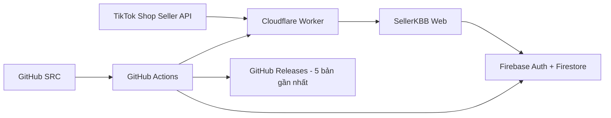

<div align="center">

# 🌸 SellerKBB

### Báo cáo TikTok LIVE · KPI nhân sự · Tự đồng bộ 24/24

**Phiên bản hiện tại: v1.33.0**

[](https://github.com/hunghienhoa/sellerkbb/releases)
[](https://github.com/hunghienhoa/sellerkbb/actions)

**Website:** https://sellerkbb.doanhsokpis.workers.dev/

**Bản xem thử:** https://sellerkbb.doanhsokpis.workers.dev/preview

</div>

---

## 🆕 Cập nhật mới nhất — v1.33.0

- Thêm tab **Đối soát đơn LIVE** theo từng phiên.
- Mỗi phiên có thể tải danh sách đơn được tạo trong đúng khoảng thời gian LIVE và xem: **mã đơn, trạng thái giao hàng, trạng thái hậu mãi, giá trị đơn và giá trị sau hủy/hoàn đã biết**.
- Tách rõ 2 mức liên kết đơn: **Có tín hiệu LIVE** và **Khớp theo thời gian**. SellerKBB không coi đơn chỉ trùng thời gian là bằng chứng tuyệt đối phát sinh từ LIVE.
- Bổ sung đọc **TikTok Orders API** và **Return/Refund API** khi token hiện tại có đủ quyền.
- Nếu TikTok chưa cấp quyền Return/Refund, giao diện vẫn hiển thị trạng thái đơn nhưng cảnh báo rõ rằng số sau hoàn chưa phải số chốt.
- Làm rõ lại cơ chế cũ: trước v1.33.0, trường “GMV sau hoàn/hủy” thực tế chỉ là GMV mới nhất trả về từ LIVE Performance API sau mỗi lần đồng bộ. Theo định nghĩa TikTok, LIVE GMV là GMV gộp và có thể bao gồm đơn hủy/hoàn, nên không được coi là GMV ròng sau hậu mãi.
- Đối soát hậu mãi căn cứ vào vòng đời đơn và mốc **Delivered**. Chính sách TikTok Shop Việt Nam hiện có cửa sổ trả/hoàn tới **15 ngày** với đa số ngành hàng; một số nhóm hàng chỉ **6 ngày**.
- KPI hiện tại **chưa tự chuyển sang số đối soát cấp đơn** để tránh tính sai khi đơn chỉ được ghép theo thời gian hoặc token thiếu quyền hậu mãi.
- Dữ liệu đối soát được cache ngắn hạn ở Cloudflare KV để tránh gọi TikTok API quá dày; nút **Làm mới** cho phép kiểm tra lại trạng thái hiện tại.
- Giữ nguyên toàn bộ fix v1.32.0 chống iPhone/Safari tự zoom khi chạm ô nhập liệu.
- README và GitHub Release được cập nhật cùng phiên bản.

---

## 👋 README này dành cho ai?

README này được viết để **người không phải dân IT vẫn có thể quản lý SellerKBB**.

Bạn không cần hiểu hết code. Chỉ cần nhớ 4 nơi chính:

| Nơi | Dùng để làm gì? | Có nên tự sửa không? |
|---|---|---|
| **GitHub** | Giữ mã nguồn (SRC), lịch sử thay đổi và Release backup | Không sửa code trực tiếp nếu không chắc |
| **Cloudflare Worker** | Chạy website + backend + tự đồng bộ TikTok | Chỉ cấu hình theo hướng dẫn |
| **Firebase** | Đăng nhập Google, tài khoản, phân quyền, dữ liệu nghiệp vụ | Không xóa collection thủ công |
| **TikTok Shop API** | Cung cấp số liệu LIVE | Không chia sẻ App Secret / token |

> **SRC là gì?** SRC = source code = toàn bộ mã nguồn để tạo ra website SellerKBB. Nếu website bị sửa lỗi, GitHub Release giúp quay lại SRC của bản trước.

---

## ✨ SellerKBB đang làm gì?

- Đăng nhập bằng Google/Firebase.
- Tài khoản mới phải chờ Admin duyệt.
- Admin chọn vai trò: **Host Livestream / Livestream operator / Admin**.
- Host và Operator không nhìn thấy phần TikTok API.
- TikTok LIVE tự đồng bộ **mỗi giờ, chạy 24/24**.
- LIVE Analytics được quét lại hằng ngày; riêng từ v1.33.0 có thêm tab đối soát cấp đơn để xem vận chuyển/hủy/hoàn rõ ràng hơn.
- Phiên LIVE mới **không tự chọn Host/Operator**; Admin chọn thủ công.
- KPI mặc định:
  - Host Livestream: **0,3% GMV dùng KPI**.
  - Livestream operator: **0,1% GMV dùng KPI**.
- **Lưu ý từ v1.33.0:** LIVE Analytics GMV của TikTok là GMV gộp và có thể bao gồm đơn hủy/hoàn. Vì vậy KPI tự động hiện được đánh dấu **tạm tính** cho tới khi dữ liệu đối soát cấp đơn đủ chắc chắn.
- **Ngày Campaign/Mega Live** có thể bật chế độ KPI thủ công; Host/Operator được để trống và phiên đó không cộng KPI tự động.
- Bộ lọc: **Hôm nay / 7 ngày / 30 Ngày / Chọn ngày**.
- Có trang Xuất file riêng.
- Lưu dữ liệu tối đa **180 ngày (6 tháng)** theo cấu hình.
- Có trang **Lưu trữ & tự dọn** theo dõi GitHub / Firebase / Cloudflare.
- Hỗ trợ PC và điện thoại.
- Giao diện **hồng pastel nhẹ**, sidebar chia rõ **Báo cáo / Công cụ / Quản trị**; **KPI thủ công** nằm ở **Công cụ**, còn **Quản lý tài khoản** nằm trong **Quản trị** và là nơi duy nhất quản lý user.

---

## 🧭 Cách sử dụng hằng ngày

### 1. Mở website

Vào website SellerKBB. Mặc định hệ thống luôn chọn **Hôm nay**.

### 2. Kiểm tra Tổng quan

- **Hôm nay:** chỉ xem các phiên của hôm nay.
- **7 ngày:** tính từ hôm nay lùi 7 ngày.
- **30 Ngày:** tổng số liệu tính đủ 30 ngày; danh sách trên Tổng quan chỉ hiện 7 ngày gần nhất để gọn.
- Bấm **Xem thêm** ở Tổng quan để chuyển sang **Phiên LIVE** và giữ nguyên bộ lọc.
- **Chọn ngày:** bấm lịch → chọn Từ ngày/Đến ngày → **Áp dụng**. Lịch sẽ tự đóng.

### 3. Gắn người cho phiên LIVE

Trong **Phiên LIVE**:

1. Chọn Host.
2. Chọn Livestream operator.
3. Bấm **Lưu**.
4. Reload lại trang vẫn phải giữ đúng người đã lưu.

Phiên LIVE tự đồng bộ mới luôn để Host/Operator **trống** để tránh tính nhầm KPI.

### 4. Campaign/Mega Live

Nếu một phiên kéo dài nhiều giờ và nhiều người thay ca:

1. Tích **Ngày Campaign/Mega Live · tính KPI thủ công**.
2. SellerKBB tự xóa lựa chọn Host/Operator của phiên đó.
3. Bấm **Lưu**.
4. Phiên vẫn xuất hiện trong doanh thu/báo cáo nhưng không cộng KPI tự động.

5. Phiên được đưa vào tab riêng **KPI thủ công** trong nhóm **Công cụ**, cùng với **Xuất file**.
6. Admin chỉ thêm những người thực sự cần tính KPI, nhập **GMV sau hoàn/hủy của cá nhân** và **KPI thủ công của cá nhân**.
7. SellerKBB không tự chia GMV tổng phiên; KPI thủ công đã lưu sẽ tự cộng vào tab **KPI nhân sự** của đúng người.

### 5. Xem KPI

Trang **KPI nhân sự** hiện lấy GMV LIVE Analytics của các phiên hợp lệ để tính **KPI tạm tính**. Không nên coi đây là KPI đã chốt sau hoàn/hủy cho tới khi phiên được đối soát cấp đơn:

```text
Host KPI tạm tính       = GMV LIVE Analytics × 0,3%
Operator KPI tạm tính   = GMV LIVE Analytics × 0,1%
```

### 6. Xuất file

Vào tab **Xuất file**. File xuất dùng đúng khoảng thời gian đang chọn. SellerKBB không đưa Session ID TikTok ra CSV.

### 7. Đối soát đơn theo từng phiên LIVE

Vào tab **Đối soát đơn LIVE**:

1. Chọn khoảng thời gian cần kiểm tra.
2. Chọn phiên LIVE và bấm **Xem đơn**.
3. SellerKBB lấy các đơn được tạo trong đúng khung thời gian phiên đó.
4. Mỗi đơn hiển thị trạng thái như **Đang vận chuyển / Đã giao / Hoàn tất / Đã hủy** và trạng thái hậu mãi như **Đang hoàn/trả / Đã hoàn tiền**.
5. Nếu đơn có tín hiệu liên kết LIVE từ dữ liệu đơn, hệ thống ghi **Có tín hiệu LIVE**.
6. Nếu chỉ khớp theo giờ tạo đơn, hệ thống ghi **Khớp theo thời gian** để tránh hiểu nhầm là đã xác minh tuyệt đối.
7. Số **Giá trị sau hủy/hoàn đã biết** chỉ phản ánh dữ liệu SellerKBB đọc được tại thời điểm đó; không tự dùng thay KPI nếu dữ liệu hậu mãi chưa đầy đủ.

> **Vì sao chưa chốt ngay sau khi giao?** Người mua vẫn có thể mở yêu cầu trả/hoàn sau khi đơn ở trạng thái Delivered. Với chính sách TikTok Shop Việt Nam hiện hành, cửa sổ này có thể tới 15 ngày với đa số nhóm hàng và 6 ngày với một số nhóm hàng. Vì vậy muốn gọi là “GMV đã chốt” phải dựa trên trạng thái đơn + hậu mãi, không chỉ dựa vào ngày LIVE.

### 8. Hồ sơ Google trên top bar

- SellerKBB dùng **ảnh đại diện Google/Gmail** của tài khoản đã đăng nhập.
- Ảnh được lưu cùng hồ sơ người dùng trong Firestore để Admin nhận diện tài khoản ở trang **Quản lý tài khoản**.
- Trên top bar chỉ hiển thị **avatar**, không hiển thị tên/vai trò và không có thanh phân cách.
- Bấm avatar để mở popup **ở chính giữa màn hình** với thông tin cơ bản: tên, Gmail, vai trò và trạng thái tài khoản.
- Popup có nút **Đăng xuất**; không có mũi tên hay biểu tượng cài đặt trên top bar.
- Nếu Google không có ảnh hoặc ảnh không tải được, SellerKBB dùng avatar chữ cái dự phòng.

---

## 🏗️ SellerKBB hoạt động như thế nào?



Hiểu đơn giản:

1. **TikTok** cung cấp dữ liệu LIVE.
2. **Cloudflare** lấy dữ liệu và chạy website.
3. **Firebase** giữ tài khoản/phân quyền/thông tin gắn Host-Operator.
4. **GitHub** giữ mã nguồn.
5. **GitHub Releases** là các điểm khôi phục SRC.

---

## 📁 Các file/thư mục quan trọng trong SRC

| Đường dẫn | Ý nghĩa |
|---|---|
| `public/index.html` | Giao diện web + phần lớn logic phía trình duyệt |
| `worker/api-template.js` | Backend Cloudflare, TikTok API, token, cron, maintenance |
| `firebase/firestore.rules` | Quyền đọc/ghi Firestore |
| `firebase/firestore.indexes.json` | Index Firestore |
| `.github/workflows/deploy.yml` | Test, deploy và tự tạo Release backup |
| `scripts/check.mjs` | Kiểm tra source trước deploy |
| `scripts/ui-browser-test.mjs` | Test thật bằng Chromium cho PC + mobile |
| `scripts/build-worker.mjs` | Ghép giao diện vào Worker để deploy |
| `wrangler.toml` | Cấu hình Cloudflare Worker/KV/Cron |
| `VERSION` | Version chuẩn của SellerKBB |
| `package.json` | Version + lệnh build/check |
| `.env.example` | Mẫu biến môi trường; không chứa secret thật |

### Không được đưa lên GitHub

- TikTok App Secret.
- TikTok Access Token / Refresh Token.
- Firebase Service Account JSON.
- Cloudflare API Token.
- Mật khẩu hoặc cookie đăng nhập.

---

## 🔐 Phân quyền tài khoản

### Admin

- Quản lý tài khoản.
- Chọn vai trò/quyền xem.
- Gắn Host/Operator.
- Bật Campaign/Mega thủ công.
- Xem TikTok/API.
- Xem Lưu trữ & tự dọn.

### Host Livestream / Livestream operator

- Chỉ xem phần được Admin cấp quyền.
- Không được thấy TikTok API/secret.

---

## 🔄 TikTok tự đồng bộ 24/24

Cloudflare Cron hiện dùng:

```text
0 * * * *    → mỗi giờ: kiểm tra token + đồng bộ LIVE gần đây
15 3 * * *   → mỗi ngày: đối soát 30 ngày + dọn KV
```

Access Token có thể hết hạn nhanh. Backend dùng **Refresh Token** để xin Access Token mới trước khi hết hạn. Nếu TikTok thu hồi quyền hoặc Refresh Token hết hiệu lực thì mới phải cấp quyền lại.

---

## 💾 Lưu trữ & tự dọn

Trang Admin **Lưu trữ & tự dọn** hiển thị:

- **GitHub:** dung lượng repository so với ngưỡng khuyến nghị.
- **Firebase:** ước tính dữ liệu SellerKBB trong Firestore.
- **Cloudflare:** dung lượng Workers KV đo được.
- % sử dụng và thanh tiến trình.
- Số phiên LIVE đang quản lý.
- Mức áp lực dọn dữ liệu.
- Số key KV và lần kiểm tra gần nhất.

Giới hạn giữ dữ liệu báo cáo tối đa **180 ngày**.

> SellerKBB không tự xóa SRC GitHub, tài khoản người dùng hoặc TikTok token được bảo vệ.

---

## 📦 Release backup tự động — chỉ giữ 5 bản gần nhất

Từ **v1.10.0**, sau khi source qua kiểm tra thành công, GitHub Actions tự:

1. Kiểm tra `VERSION`, `package.json`, `wrangler.toml` và version giao diện phải khớp nhau.
2. Chạy kiểm tra source.
3. Chạy Chromium smoke test cho **PC + mobile**.
4. Build Worker.
5. Deploy Cloudflare/Firebase nếu GitHub Secrets đã được cấu hình.
6. Tạo/cập nhật Release `vX.Y.Z`.
7. Đính kèm `sellerkbb-vX.Y.Z-src.zip`.
8. Giữ đúng **5 Release mới nhất tính cả bản vừa tạo**.
9. Tự xóa Release/tag từ bản thứ 6 trở về trước.

### Release backup được những gì?

✅ Mã nguồn/SRC đúng của phiên bản đó.

✅ Workflow, Firebase rules, giao diện, backend, test.

✅ Có thể dùng để quay lại bản web cũ.

### Release KHÔNG backup những gì?

❌ Dữ liệu Firestore đang chạy.

❌ Dữ liệu Cloudflare KV thực tế.

❌ TikTok token.

❌ Firebase/Cloudflare secret.

> Vì vậy “khôi phục Release” nghĩa là **khôi phục phiên bản phần mềm**, không phải phục hồi dữ liệu nghiệp vụ đã bị xóa.

---

## ⏪ Cách quay lại bản cũ nếu bản mới bị lỗi

### Cách dễ nhất khi bạn dùng AI

1. Mở: https://github.com/hunghienhoa/sellerkbb/releases
2. Chọn một trong **5 Release gần nhất** mà bạn biết đang chạy tốt.
3. Copy link Release.
4. Gửi cho AI câu này:

> Khôi phục SellerKBB về đúng Release này: [DÁN LINK]. Không làm mất dữ liệu Firebase/TikTok. Sau khi khôi phục hãy chạy test PC/mobile, deploy Cloudflare rồi xác nhận version đang chạy.

AI có thể đọc tag/Release và đưa branch `main` trở lại source tương ứng.

### Nếu chỉ muốn tải bản backup về máy

Trong Release → **Assets** → tải:

```text
sellerkbb-vX.Y.Z-src.zip
```

Giữ file ZIP đó ở máy nếu muốn có thêm một bản backup cá nhân.

---

## 🚀 Quy trình cập nhật một phiên bản an toàn

Mỗi lần nhờ AI sửa, nên yêu cầu đúng quy trình:

1. Đọc source hiện tại từ GitHub.
2. Chỉ sửa đúng yêu cầu.
3. Không ghi secret vào source.
4. Bump version.
5. Chạy `npm run check`.
6. Chạy Chromium test PC/mobile.
7. Chỉ deploy khi test PASS.
8. Kiểm tra Worker sau deploy.
9. GitHub Actions tự tạo Release backup.
10. Đảm bảo danh sách Releases chỉ còn 5 bản gần nhất.

### Mẫu câu bạn có thể gửi cho AI

> Hãy sửa SellerKBB theo yêu cầu dưới đây. Đọc source hiện tại trên GitHub trước khi sửa. Sau khi sửa phải test PC và mobile, không deploy nếu test fail. Không làm mất dữ liệu Firebase/Cloudflare/TikTok. Bump version, deploy bản đã test và kiểm tra Release backup tự động chỉ giữ 5 bản gần nhất.

---

## 🧪 Kiểm tra source

Các lệnh dành cho AI/developer:

```bash
npm run check
npm install --no-save puppeteer-core
node scripts/ui-browser-test.mjs
npm run build
```

File Worker sau build:

```text
dist/worker.mjs
```

Không commit `dist/` nếu workflow đang tự build.

---

## 🔥 Cấu hình Firebase lần đầu

1. Tạo Firebase Project.
2. Bật **Authentication → Google**.
3. Tạo **Firestore Database**.
4. Tạo **Web App** và lấy các giá trị:

```text
FIREBASE_API_KEY
FIREBASE_AUTH_DOMAIN
FIREBASE_PROJECT_ID
FIREBASE_STORAGE_BUCKET
FIREBASE_MESSAGING_SENDER_ID
FIREBASE_APP_ID
```

5. Thêm domain Worker vào **Authorized domains** của Firebase Auth.
6. Deploy `firebase/firestore.rules` và `firebase/firestore.indexes.json`.

### GitHub Actions Secrets cho Firebase

```text
FIREBASE_SERVICE_ACCOUNT
FIREBASE_PROJECT_ID
```

`FIREBASE_SERVICE_ACCOUNT` phải để ở GitHub Secrets, tuyệt đối không commit vào repo.

---

## ☁️ Cấu hình Cloudflare lần đầu

Worker cần:

- KV binding tên **`TIKTOK_KV`**.
- Cron hourly + daily reconciliation.
- Các Firebase vars.
- TikTok vars/secrets.

### GitHub Actions Secrets cho Cloudflare

```text
CLOUDFLARE_API_TOKEN
CLOUDFLARE_ACCOUNT_ID
```

Nếu 2 secret này chưa có, GitHub Actions vẫn chạy test/build nhưng sẽ bỏ qua bước deploy Cloudflare.

---

## 🎵 Cấu hình TikTok Shop API

Các thông tin cần có:

```text
TIKTOK_APP_KEY
TIKTOK_APP_SECRET      ← SECRET, không đưa lên GitHub
TIKTOK_SERVICE_ID
TIKTOK_SELLER_AUTH_URL
```

Redirect URL:

```text
https://<worker-domain>/api/tiktok/oauth/callback
```

Quyền tối thiểu phải phù hợp với TikTok Shop Analytics/LIVE API đang dùng. Khi TikTok thay API/scope, cần kiểm tra tài liệu Partner Center hiện hành trước khi đổi.

---

## 🛠️ Khi có lỗi, kiểm tra theo thứ tự này

### Web mở được nhưng không có dữ liệu TikTok

1. Vào Admin → **TikTok / API**.
2. Xem trạng thái kết nối.
3. Kiểm tra lần đồng bộ gần nhất.
4. Nếu Refresh Token mất hiệu lực thì cấp quyền TikTok lại.

### Đăng nhập Google lỗi

1. Kiểm tra Firebase Authentication đã bật Google.
2. Kiểm tra domain Worker đã nằm trong Authorized domains.
3. Kiểm tra Firebase web config.

### Lưu Host/Operator rồi reload bị mất

- Không sửa Firestore rules thủ công.
- Chạy browser test desktop/mobile.
- Kiểm tra đúng Admin đang đăng nhập và Firestore write không bị từ chối.

### Bản mới lỗi giao diện

- Không sửa chồng thêm khi chưa rõ nguyên nhân.
- Vào **Releases** và quay lại một bản đã chạy tốt.

---

## 🛡️ Nguyên tắc an toàn của dự án

- **GitHub `main` là nguồn SRC chính.**
- Không xóa repo để “dọn dung lượng”.
- Không đưa secret/token vào commit, README, issue hay ảnh chụp.
- Không tự chia GMV Campaign/Mega theo thời gian nếu không có GMV từng ca.
- Không hiển thị TikTok LIVE Session ID ra giao diện/CSV.
- Khi sửa chức năng lưu dữ liệu phải test cả desktop và mobile.
- Bản mới chỉ được coi là hoàn thành khi source check + browser smoke test PASS.

---

## 📌 Version

Version phải đồng bộ ở:

```text
VERSION
package.json
wrangler.toml
public/index.html
```

Workflow Release sẽ tự chặn nếu các version này không khớp.

---

<div align="center">

**SellerKBB · quản lý bằng GitHub + Cloudflare + Firebase + TikTok Shop API**

Khi không chắc phải sửa gì, hãy giữ nguyên Release gần nhất đang chạy tốt và nhờ AI kiểm tra trước.

</div>
