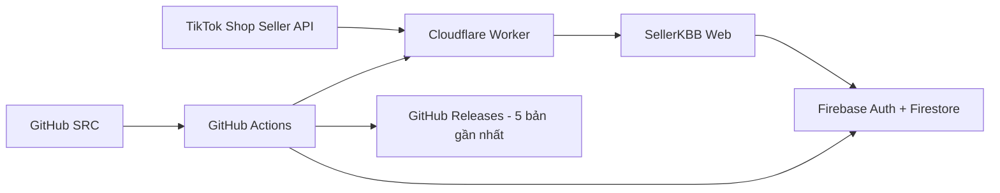

<div align="center">

# 🌸 SellerKBB

### Báo cáo TikTok LIVE · KPI nhân sự · Tự đồng bộ 24/24

**Phiên bản hiện tại: v1.47.0**

[](https://github.com/hunghienhoa/sellerkbb/releases)
[](https://github.com/hunghienhoa/sellerkbb/actions)

**Website:** https://sellerkbb.doanhsokpis.workers.dev/

**Bản xem thử:** https://sellerkbb.doanhsokpis.workers.dev/preview

</div>

---

## 🆕 Cập nhật mới nhất — v1.47.0

- Audit 10 mục SellerKBB trên PC, tablet và mobile; giữ nhận diện **hồng pastel + Be Vietnam Pro**, áp dụng có chọn lọc nguyên tắc typography của Impeccable và motion có mục đích của Emil Kowalski.
- Tăng độ rõ của nhãn/chú thích số liệu, căn số theo độ rộng cố định, giảm chữ đậm lặp lại trong bảng và làm nhẹ nền/viền card. Nút chính, bộ lọc và trạng thái có tương phản rõ hơn.
- Sửa tràn ngang ở **Xuất file / Quản lý tài khoản / Quản lý nhân sự** trên màn hình 320px; nút thao tác mobile cao tối thiểu 44px, input vẫn từ 16px.
- Popup mở nhẹ trong 180ms, giữ Tab bên trong, khóa tương tác nền và trả focus khi đóng; hỗ trợ Escape và giảm chuyển động. Bỏ ripple và animation lặp lại khi chuyển mục.
- Bổ sung tên truy cập cho dropdown Host/Vận hành và thanh dung lượng; giữ trạng thái thành công, tạm tính, lỗi bằng chữ kèm màu.
- Xác minh lại **Lưu Host/Vận hành → ẩn hai dropdown → tóm tắt + Sửa**, sửa/lưu lại/tải lại trên PC/mobile. Giữ nguyên logic TikTok, đối soát, Campaign/Mega Live và KPI.
- Bổ sung audit responsive, lỗi JavaScript, bàn phím và giảm chuyển động; quy trình tự test → deploy Cloudflare/Firebase → Release tiếp tục giữ tối đa **5 Release**.


---

## 👋 README này dành cho ai?

README này được viết để **người không phải dân IT vẫn có thể quản lý SellerKBB**.

Bạn không cần hiểu hết code. Chỉ cần nhớ 4 nơi chính:

| Nơi | Dùng để làm gì? | Có nên tự sửa không? |
|---|---|---|
| **GitHub** | Giữ mã nguồn (SRC), lịch sử thay đổi và Release backup | Không sửa code trực tiếp nếu không chắc |
| **Cloudflare Worker** | Chạy website + backend + tự đồng bộ TikTok | Chỉ cấu hình theo hướng dẫn |
| **Firebase** | Đăng nhập Google, tài khoản, phân quyền, dữ liệu nghiệp vụ | Không xóa collection thủ công |
| **TikTok Shop API** | Cung cấp số liệu LIVE | Không chia sẻ App Secret / token |

> **SRC là gì?** SRC = source code = toàn bộ mã nguồn để tạo ra website SellerKBB. Nếu website bị sửa lỗi, GitHub Release giúp quay lại SRC của bản trước.

---

## ✨ SellerKBB đang làm gì?

- Đăng nhập bằng Google/Firebase.
- Tài khoản mới phải chờ Admin duyệt.
- Admin chọn vai trò: **Host Livestream / Livestream operator / Admin**.
- Host và Operator không nhìn thấy phần TikTok API.
- TikTok LIVE tự đồng bộ **mỗi giờ, chạy 24/24**.
- LIVE Analytics được quét lại hằng ngày; riêng từ v1.33.0 có thêm tab đối soát cấp đơn để xem vận chuyển/hủy/hoàn rõ ràng hơn.
- Phiên LIVE mới **không tự chọn Host/Operator**; Admin chọn thủ công.
- KPI mặc định:
  - Host Livestream: **0,3% GMV dùng KPI**.
  - Livestream operator: **0,1% GMV dùng KPI**.
- **Từ v1.37.0:** giao diện dùng 3 tên rõ ràng: **GMV đã ghi nhận / GMV chờ đối soát / GMV sau khi hoàn hủy**. KPI tự động chỉ dùng đơn có tín hiệu LIVE chắc chắn; đơn chỉ khớp thời gian không được tính KPI.
- **Ngày Campaign/Mega Live** có thể bật chế độ KPI thủ công; sau khi tích phải chọn rõ **Ngày Campaign** hoặc **Mega Live**. Hai ô Host/Operator tự động được ẩn hẳn và phiên đó không cộng KPI tự động.
- Bộ lọc: **Hôm nay / 7 ngày / 30 Ngày / Chọn ngày**.
- Có trang Xuất file riêng.
- Lưu dữ liệu **60–180 ngày** theo cấu hình; 60 ngày gần nhất được bảo vệ để phục vụ đối soát đơn và hậu mãi.
- Có trang **Lưu trữ & tự dọn** theo dõi GitHub / Firebase / Cloudflare.
- Hỗ trợ PC và điện thoại.
- Giao diện **hồng pastel nhẹ**, sidebar chia rõ **Báo cáo / Công cụ / Quản trị**; **KPI thủ công** nằm ở **Công cụ**, còn **Quản lý tài khoản** nằm trong **Quản trị** và là nơi duy nhất quản lý user.

---

## 🧭 Cách sử dụng hằng ngày

### 1. Mở website

Vào website SellerKBB. Mặc định hệ thống luôn chọn **Hôm nay**.

Giao diện v1.47.0 giữ hồng pastel, dùng chữ lớn hơn cho nhãn số liệu và phân biệt nút chính bằng hồng đậm. Trên điện thoại, nút thao tác có vùng chạm lớn hơn; màn hình rất hẹp chuyển cụm số liệu sang một cột để tránh cắt số.

**Dùng bàn phím:** Tab để di chuyển, Enter/Space để kích hoạt. Khi mở popup tài khoản/đối soát, Tab chỉ đi trong popup; Escape đóng và đưa focus về nút mở. Nếu thiết bị bật **Giảm chuyển động**, popup không chạy animation. Nút làm mới vẫn thể hiện trạng thái **Đang tải** bằng chữ.

### Quy tắc KPI tự động cho 2 kênh nội bộ

SellerKBB chỉ dùng `shopkhangbaby` và `mekhangsua`.

- Chỉ một kênh đang LIVE trong thời điểm đơn phát sinh → đơn khớp thời gian được cộng vào **GMV/KPI tạm tính**.
- Hai kênh LIVE chồng giờ → không gán cùng một đơn trực tiếp cho cả hai phiên. SellerKBB dùng GMV Analytics riêng từng phiên và áp dụng tỷ lệ hủy/hoàn của đơn trong khung giờ.
- Đơn hủy có GMV KPI = 0; đơn hoàn tiền được trừ theo dữ liệu Return/Refund.
- Khi đơn còn chờ đóng/giao/hậu mãi → chỉ là **tạm tính**.
- Khi toàn bộ đơn dùng KPI đã kết thúc và không còn hậu mãi đang xử lý → phiên chuyển **Đã chốt**.

### 2. Kiểm tra Tổng quan

Tổng quan hiển thị 4 ô chỉ số chính như cũ và thêm một thẻ ngang **GMV sau khi hoàn hủy** ngay bên dưới. Số GMV này chỉ cộng những phiên đã chốt/đã đối soát; các phiên còn tạm tính không được cộng vào đây.

Trong danh sách phiên bên dưới, phiên đã chốt được đánh dấu bằng **✓ Đã đối soát** và tông xanh nhẹ để không bị nhầm với phiên tạm tính màu hồng/vàng.

- **Hôm nay:** chỉ xem các phiên của hôm nay.
- **7 ngày:** tính từ hôm nay lùi 7 ngày.
- **30 Ngày:** tổng số liệu tính đủ 30 ngày; danh sách trên Tổng quan chỉ hiện 7 ngày gần nhất để gọn.
- Bấm **Xem thêm** ở Tổng quan để chuyển sang **Phiên LIVE** và giữ nguyên bộ lọc.
- **Chọn ngày:** bấm lịch → chọn Từ ngày/Đến ngày → **Áp dụng**. Lịch sẽ tự đóng.

### 3. Gắn người cho phiên LIVE

Trong **Phiên LIVE**:

1. Chọn Host.
2. Chọn Livestream operator.
3. Bấm **Lưu** / **Lưu thiết lập**.
4. Khi đã lưu đủ cả hai người trên **PC và điện thoại**, hai ô chọn và nút **Lưu** tự ẩn; chỉ hiện tóm tắt tên Host/Vận hành cùng nút **Sửa**.
5. Khi cần đổi người, bấm **Sửa** để mở lại hai ô chọn và nút **Lưu** của đúng phiên đó. Lưu thành công thì form tự thu gọn lại.
6. Reload lại trang vẫn phải giữ đúng người đã lưu và tiếp tục ở trạng thái thu gọn nếu đã đủ Host/Vận hành.

Phiên LIVE tự đồng bộ mới luôn để Host/Operator **trống** để tránh tính nhầm KPI; nếu mới gán thiếu một người thì SellerKBB chưa thu gọn phần chọn.

### 4. Campaign/Mega Live

Nếu một phiên kéo dài nhiều giờ và nhiều người thay ca:

1. Tích **Ngày Campaign/Mega Live · tính KPI thủ công**.
2. SellerKBB hiện thêm ô **Gắn thẻ loại phiên**.
3. Chọn **Ngày Campaign** hoặc **Mega Live**. Đây là lựa chọn bắt buộc trước khi lưu.
4. SellerKBB tự xóa lựa chọn Host/Operator tự động của phiên đó và **ẩn hẳn hai ô Host Livestream / Nhân viên vận hành** khỏi card phiên LIVE.
5. Bấm **Lưu/Lưu thiết lập**. Sau khi lưu, ô chọn loại phiên tự thu gọn, chỉ còn loại đã chọn ở bên trái và nút **Sửa** gọn bên phải. Bấm **Sửa** để mở lại ô chọn khi cần đổi Campaign/Mega.
6. Thẻ loại phiên vẫn hiển thị ngay trên phiên LIVE và trong tab KPI thủ công. Nếu bỏ tích KPI thủ công, hai ô Host/Vận hành sẽ hiện lại để cấu hình lại chế độ KPI tự động.
7. Phiên vẫn xuất hiện trong doanh thu/báo cáo nhưng **không cộng KPI tự động**.
8. Phiên được đưa vào tab **KPI thủ công** trong nhóm **Công cụ**.
9. Admin thêm những Host/Operator thực sự cần tính và nhập **GMV sau hoàn/hủy của từng Host**.
10. KPI Host tự tính = GMV Host × **0,3%**; KPI Vận hành đi cùng Host = GMV Host × **0,1%**.
11. SellerKBB không tự chia GMV tổng phiên cho các Host.

#### Cách nhập từng cặp Host / Vận hành

- Khi thêm người mới, SellerKBB mở đầy đủ ô **Host / Vận hành / GMV sau hoàn hủy của Host / KPI Host / KPI Vận hành**.
- Sau khi bấm **Lưu KPI thủ công**, cặp đã lưu được thu gọn thành một dòng chỉ còn tên **Host**, tên **Vận hành** và nút **Chi tiết**.
- Đồng thời, cả khối KPI của phiên được thu gọn thành **✓ KPI thủ công đã lưu**. Bấm **Sửa KPI** để mở lại phần nhập; sau đó từng cặp đã lưu vẫn dùng nút **Chi tiết** để chỉnh đúng người.
- Bấm **Chi tiết** để mở lại phần tính KPI và chỉnh sửa.
- Ô GMV chỉ chứa phần số; chữ **đ** được giữ cố định bên phải nên có thể đặt con trỏ/xóa số bình thường.
- Nút **Xóa người** nằm ở cuối phần Chi tiết của đúng cặp, tránh bấm nhầm khi đang nhập người mới.
- SellerKBB không yêu cầu nhập giờ riêng cho từng cặp nhân sự.

#### Kiểm soát GMV thủ công

SellerKBB so sánh **tổng GMV các Host đã nhập** với **GMV sau khi hoàn hủy đã chốt của cả phiên**:

- ✅ **Bằng nhau:** hợp lệ hoàn toàn.
- 🟡 **Nhỏ hơn:** vẫn cho lưu; hiển thị số GMV còn chưa phân bổ.
- 🔴 **Lớn hơn:** chặn lưu và hiển thị chính xác số tiền vượt.
- 🟣 **Phiên chưa có số chốt:** cho **Lưu nháp**; dữ liệu chưa cộng vào KPI đã chốt.

Khi một bản nháp sau đó có GMV sau khi hoàn hủy:
- nếu tổng Host ≤ số chốt → dữ liệu đủ điều kiện tính KPI;
- nếu tổng Host > số chốt → không cộng KPI và yêu cầu Admin chỉnh lại.

### 5. Xem KPI

#### Ba loại GMV cần phân biệt

| Tên trên SellerKBB | Ý nghĩa | Dùng tính KPI? |
|---|---|---|
| **GMV đã ghi nhận** | Số TikTok cập nhật mới nhất của đúng phiên LIVE. Sau khi LIVE kết thúc, nếu TikTok tiếp tục xác nhận dữ liệu của phiên thì số này vẫn được cập nhật. | Không dùng trực tiếp |
| **GMV chờ đối soát** | GMV tạm tính sau hủy/hoàn đã biết của **các đơn có tín hiệu LIVE**. Có thể thay đổi khi đơn giao, hủy hoặc hoàn tiền. | Có, nhưng chỉ là KPI tạm tính |
| **GMV sau khi hoàn hủy** | GMV cuối cùng của các đơn có tín hiệu LIVE sau khi trạng thái đơn/hậu mãi đã kết thúc. | Có, dùng chốt KPI |

Đơn **Khớp theo thời gian** chỉ dùng để đối chiếu và cảnh báo. Từ v1.37.0, giá trị của các đơn này **không được cộng vào KPI tự động**.

#### Ví dụ tính GMV

Một phiên có các đơn có tín hiệu LIVE:

```text
Đơn A: 40.000.000đ · hoàn tất                  → 40.000.000đ
Đơn B: 30.000.000đ · đã hủy                    →          0đ
Đơn C: 25.000.000đ · đã hoàn 10.000.000đ       → 15.000.000đ
Đơn D: 15.000.000đ · đang vận chuyển            → 15.000.000đ tạm tính
```

**GMV chờ đối soát = 40 + 0 + 15 + 15 = 70.000.000đ.**

Nếu sau đó Đơn D bị hủy thì số giảm còn **55.000.000đ**.  
Nếu Đơn D hoàn tất và không còn hậu mãi thì số cuối cùng là **70.000.000đ**.

#### KPI tự động

Chỉ áp dụng cho phiên **không tích Tính KPI thủ công**:

```text
Host KPI       = GMV đối soát có tín hiệu LIVE × 0,3%
Operator KPI   = GMV đối soát có tín hiệu LIVE × 0,1%
```

- **KPI tạm tính:** đã có GMV chờ đối soát nhưng còn đơn/hậu mãi chưa kết thúc.
- **KPI đã chốt:** đã có GMV sau khi hoàn hủy cuối cùng.
- **Chờ đối soát:** chưa đủ dữ liệu Orders/Return & Refund hoặc chưa có đơn đủ tín hiệu LIVE; hệ thống không dùng GMV đã ghi nhận để tính thay.
- **KPI dự kiến = KPI đã chốt + KPI tạm tính.**

#### Cách đọc 2 bảng KPI nhân sự

- **KPI chưa chốt:** dùng để theo dõi số còn biến động. Bảng này chỉ có **GMV chờ đối soát / KPI tạm tính / số phiên chờ đối soát**.
- **KPI đã chốt:** dùng để thanh toán. Bảng này tách **GMV tự động đã chốt / GMV thủ công / KPI tự động đã chốt / KPI thủ công / Tổng KPI đã chốt**.
- Nếu cùng một người vừa có phiên đã chốt vừa có phiên chưa chốt thì người đó sẽ xuất hiện ở **cả hai bảng**.

#### KPI thủ công

- Phiên đã tích **Tính KPI thủ công** không chạy KPI tự động.
- Chỉ GMV của **Host** được dùng làm phần phân bổ; Operator đi cùng Host dùng cùng nền GMV đó để tính 0,1%.
- KPI thủ công chỉ được cộng vào KPI đã chốt khi phiên có **GMV sau khi hoàn hủy** và tổng GMV Host không vượt số chốt.
- Bản nháp chưa có số chốt không được cộng vào KPI đã chốt.

### 6. Xuất file

Vào tab **Xuất file**. File xuất dùng đúng khoảng thời gian đang chọn. SellerKBB không đưa Session ID TikTok ra CSV.

### 7. Đối soát đơn theo từng phiên LIVE

Vào tab **Đối soát đơn LIVE**:

1. Chọn khoảng thời gian cần kiểm tra.
2. Chọn phiên LIVE và bấm **Xem đơn**.
3. SellerKBB mở một **popup riêng**; trên mobile popup chiếm toàn màn hình và khóa cuộn trang phía sau.
4. Nút **Xem đơn** của phiên đang mở sẽ tạm ẩn; dùng **Làm mới** trong popup nếu muốn lấy trạng thái mới nhất.
5. SellerKBB lấy các đơn được tạo trong đúng khung thời gian phiên đó.
6. Mỗi đơn được gắn thẻ rõ: **Chờ đóng hàng / Chờ vận chuyển / Đang vận chuyển / Đang giao / Đã giao / Hoàn tất / Đã hủy**; nếu có hậu mãi sẽ ưu tiên thẻ **Đang hoàn/trả / Đã hoàn tiền**.
7. Nếu đơn có tín hiệu liên kết LIVE từ dữ liệu đơn, hệ thống ghi **Có tín hiệu LIVE**.
8. Nếu chỉ khớp theo giờ tạo đơn, hệ thống ghi **Khớp theo thời gian** để tránh hiểu nhầm là đã xác minh tuyệt đối.
9. Dùng các thẻ trạng thái phía trên danh sách để lọc nhanh đơn cần kiểm tra.
10. Đóng popup bằng nút **×**; khi đóng, nút **Xem đơn** của phiên đó hiện lại.
11. Popup hiển thị riêng **GMV đã ghi nhận / GMV chờ đối soát / GMV sau khi hoàn hủy**.
12. Chỉ đơn **Có tín hiệu LIVE** mới được cộng vào GMV dùng KPI.
13. Đơn **Khớp theo thời gian** vẫn hiển thị để kiểm tra nhưng được ghi rõ **không tính KPI**.
14. Nếu thiếu quyền/dữ liệu Return & Refund, phiên chuyển sang **Chờ đối soát** và không lấy GMV đã ghi nhận để tính thay.
15. Phiên đã chốt/đối soát thành công được gắn thẻ xanh **✓ Đã đối soát** và dùng nền trung tính để dễ phân biệt với phiên còn xử lý.

> **Vì sao chưa chốt ngay sau khi giao?** Người mua vẫn có thể mở yêu cầu trả/hoàn sau khi đơn ở trạng thái Delivered. Với chính sách TikTok Shop Việt Nam hiện hành, cửa sổ này có thể tới 15 ngày với đa số nhóm hàng và 6 ngày với một số nhóm hàng. Vì vậy muốn gọi là “GMV đã chốt” phải dựa trên trạng thái đơn + hậu mãi, không chỉ dựa vào ngày LIVE.

### 8. Hồ sơ Google trên top bar

- SellerKBB dùng **ảnh đại diện Google/Gmail** của tài khoản đã đăng nhập.
- Ảnh được lưu cùng hồ sơ người dùng trong Firestore để Admin nhận diện tài khoản ở trang **Quản lý tài khoản**.
- Trên top bar chỉ hiển thị **avatar**, không hiển thị tên/vai trò và không có thanh phân cách.
- Bấm avatar để mở popup **ở chính giữa màn hình** với thông tin cơ bản: tên, Gmail, vai trò và trạng thái tài khoản.
- Popup có nút **Đăng xuất**; không có mũi tên hay biểu tượng cài đặt trên top bar.
- Nếu Google không có ảnh hoặc ảnh không tải được, SellerKBB dùng avatar chữ cái dự phòng.

---

## 🧾 Lịch sử thay đổi gần đây

README giữ lại phần này để nhân sự có thể biết **vì sao giao diện/cách tính hiện tại khác bản cũ**.

| Phiên bản | Thay đổi chính |
|---|---|
| **v1.47.0** | Audit UI/UX 10 mục, typography dễ đọc, giảm viền/nền trang trí, tăng tương phản và vùng chạm, sửa tràn ngang 320px; popup hỗ trợ bàn phím/giảm chuyển động; xác minh thu gọn Host/Vận hành PC/mobile. Không đổi logic TikTok/KPI. |
| **v1.46.7** | PC tự ẩn dropdown Host/Vận hành sau khi lưu, hiện tóm tắt và nút **Sửa** giống mobile; lưu lại tiếp tục thu gọn. Giữ nguyên Campaign/Mega Live/KPI thủ công; bổ sung kiểm thử và hỗ trợ kiểm tra trên Windows. |
| **v1.46.3** | Xóa lỗi TikTok cũ khỏi trạng thái sau khi đồng bộ thành công; tránh báo `tiktok_not_connected` dù Seller Token đã có. |
| **v1.46.2** | Fix triệt để Firestore 10.000: tách query limit/total cap, dùng pagination 5.000/trang và regression test chặn tái phát. |
| **v1.46.1** | Sửa màn hình trắng khi bật Firebase thật: phân trang Firestore dưới giới hạn 10.000/truy vấn và thêm xử lý lỗi startup. |
| **v1.46.0** | Hardening trước khi chạy thật: quét đủ đơn không cắt 1.000, khóa KPI khi LIVE cùng shop chồng giờ, Order Details cho cron, Đồng bộ ngay, readiness checklist, backup JSON và `keep_vars` an toàn khi deploy. |
| **v1.45.2** | Nút **Làm mới** trong popup Đối soát đơn LIVE dùng icon đồng bộ và xoay khi đang tải, có trạng thái Đang tải/aria-busy và tự dừng khi hoàn tất. |
| **v1.45.1** | Fix bố cục Campaign/Mega đã lưu trên mobile: tên loại phiên và nút **Sửa** cân đối, không tràn/không kéo nút full width. |
| **v1.45.0** | Thu gọn loại Campaign/Mega sau khi lưu và thu gọn toàn bộ khối KPI thủ công sau khi lưu; thêm nút **Sửa** / **Sửa KPI** để mở lại khi cần chỉnh. |
| **v1.44.0** | Mobile Phiên LIVE tự thu gọn Host/Vận hành sau khi lưu đủ, hiển thị tên đã gán và nút **Sửa** để mở lại bộ chọn khi cần đổi người. |
| **v1.43.0** | Phiên LIVE đã chốt trên Tổng quan/Phiên LIVE dùng **✓ xanh + nền/viền xanh nhẹ**, không còn nhìn như trạng thái hồng tạm tính. |
| **v1.42.0** | KPI thủ công thu gọn người đã lưu, sửa ô tiền với hậu tố **đ** cố định, bố trí lại nút xóa và thêm trạng thái xanh **Đã đối soát**. |
| **v1.41.0** | Tổng quan bổ sung thẻ full-width **GMV sau khi hoàn hủy** chỉ cộng các phiên đã chốt/đã đối soát. |
| **v1.40.0** | Khi bật KPI thủ công, ẩn hẳn Host/Vận hành tự động trên PC/mobile; bỏ tích thì hiện lại. |
| **v1.39.0** | Tách KPI nhân sự thành **KPI chưa chốt** và **KPI đã chốt** để không trộn số tạm tính với số dùng thanh toán. |
| **v1.38.0** | KPI thủ công bắt buộc gắn thẻ **Ngày Campaign** hoặc **Mega Live**; lưu cùng phiên, hiển thị lại sau reload và xuất CSV. |
| **v1.37.0** | Chuẩn hóa 3 loại GMV; loại đơn chỉ khớp thời gian khỏi KPI; thêm kiểm soát thiếu/vượt cho KPI thủ công và chế độ Lưu nháp. |
| **v1.36.1** | KPI tự động chuyển sang GMV đối soát; thêm lớp an toàn không chốt khi liên kết LIVE chưa chắc chắn. |
| **v1.36.0** | Tách KPI Đã chốt / Tạm tính / Chờ đối soát / Dự kiến; cron tự cập nhật KPI đối soát. |
| **v1.35.0** | Xem đơn bằng popup riêng; mobile full-screen; khóa cuộn nền để tránh vuốt nhầm sang phiên khác. |
| **v1.34.0** | Thiết kế lại giao diện đối soát, thêm thẻ trạng thái đơn và bảo vệ dữ liệu phiên LIVE tối thiểu 60 ngày. |
| **v1.33.0** | Thêm đối soát đơn theo từng phiên LIVE; làm rõ LIVE Analytics GMV là số gộp, không phải GMV sau hoàn/hủy. |
| **v1.32.0** | Hoàn thiện KPI thủ công theo tab riêng, avatar tài khoản trên top bar và các fix mobile/iPhone Safari chống tự zoom khi nhập liệu. |

> **Quy tắc bắt buộc cho mọi bản cập nhật sau:** cập nhật đồng thời **Cập nhật mới nhất + Hướng dẫn sử dụng hiện tại + Lịch sử thay đổi** trong README; chạy kiểm thử PC/mobile; đẩy bản chính lên website và kiểm tra **Bản xem thử /preview**; tạo GitHub Release có mô tả rõ thay đổi; chỉ giữ **5 Releases mới nhất**. Không coi một bản là hoàn tất nếu source đã lên GitHub nhưng website chưa chạy đúng version mới.

---

## 🏗️ SellerKBB hoạt động như thế nào?



Hiểu đơn giản:

1. **TikTok** cung cấp dữ liệu LIVE.
2. **Cloudflare** lấy dữ liệu và chạy website.
3. **Firebase** giữ tài khoản/phân quyền/thông tin gắn Host-Operator.
4. **GitHub** giữ mã nguồn.
5. **GitHub Releases** là các điểm khôi phục SRC.

---

## 📁 Các file/thư mục quan trọng trong SRC

| Đường dẫn | Ý nghĩa |
|---|---|
| `public/index.html` | Giao diện web + phần lớn logic phía trình duyệt |
| `worker/api-template.js` | Backend Cloudflare, TikTok API, token, cron, maintenance |
| `firebase/firestore.rules` | Quyền đọc/ghi Firestore |
| `firebase/firestore.indexes.json` | Index Firestore |
| `.github/workflows/deploy.yml` | Test, deploy và tự tạo Release backup |
| `scripts/check.mjs` | Kiểm tra source trước deploy |
| `scripts/ui-browser-test.mjs` | Test thật bằng Chromium cho PC + mobile |
| `scripts/build-worker.mjs` | Ghép giao diện vào Worker để deploy |
| `wrangler.toml` | Cấu hình Cloudflare Worker/KV/Cron |
| `VERSION` | Version chuẩn của SellerKBB |
| `package.json` | Version + lệnh build/check |
| `.env.example` | Mẫu biến môi trường; không chứa secret thật |

### Không được đưa lên GitHub

- TikTok App Secret.
- TikTok Access Token / Refresh Token.
- Firebase Service Account JSON.
- Cloudflare API Token.
- Mật khẩu hoặc cookie đăng nhập.

---

## 🔐 Phân quyền tài khoản

### Admin

- Quản lý tài khoản.
- Chọn vai trò/quyền xem.
- Gắn Host/Operator.
- Bật Campaign/Mega thủ công.
- Xem TikTok/API.
- Xem Lưu trữ & tự dọn.

### Host Livestream / Livestream operator

- Chỉ xem phần được Admin cấp quyền.
- Không được thấy TikTok API/secret.

---

## 🔄 TikTok tự đồng bộ 24/24

Cloudflare Cron hiện dùng:

```text
0 * * * *    → mỗi giờ: kiểm tra token + đồng bộ LIVE gần đây + cập nhật KPI đối soát các phiên mới
15 3 * * *   → mỗi ngày: quét LIVE 30 ngày + tiếp tục đối soát các phiên chưa chốt trong vùng bảo vệ 60 ngày + dọn KV
```

Access Token có thể hết hạn nhanh. Backend dùng **Refresh Token** để xin Access Token mới trước khi hết hạn. Nếu TikTok thu hồi quyền hoặc Refresh Token hết hiệu lực thì mới phải cấp quyền lại.

---

## 💾 Lưu trữ & tự dọn

Trang Admin **Lưu trữ & tự dọn** hiển thị:

- **GitHub:** dung lượng repository so với ngưỡng khuyến nghị.
- **Firebase:** ước tính dữ liệu SellerKBB trong Firestore.
- **Cloudflare:** dung lượng Workers KV đo được.
- % sử dụng và thanh tiến trình.
- Số phiên LIVE đang quản lý.
- Mức áp lực dọn dữ liệu.
- Số key KV và lần kiểm tra gần nhất.

Giới hạn giữ dữ liệu báo cáo tối đa **180 ngày** và tối thiểu **60 ngày**.

> **Bảo vệ đối soát:** SellerKBB không tự xóa phiên LIVE trong 60 ngày gần nhất, kể cả khi Firestore chạm ngưỡng dọn khẩn cấp. Mốc 60 ngày là vùng đệm vận hành để không làm mất phiên trước khi vòng đời giao hàng + hậu mãi kết thúc. Cache kết quả đối soát 10 phút trong Cloudflare KV có thể hết hạn vì có thể tải lại từ TikTok.

> SellerKBB không tự xóa SRC GitHub, tài khoản người dùng hoặc TikTok token được bảo vệ.

---

## 📦 Release backup tự động — chỉ giữ 5 bản gần nhất

Từ **v1.10.0**, sau khi source qua kiểm tra thành công, GitHub Actions tự:

1. Kiểm tra `VERSION`, `package.json`, `wrangler.toml` và version giao diện phải khớp nhau.
2. Chạy kiểm tra source.
3. Chạy Chromium smoke test cho **PC + mobile**.
4. Build Worker.
5. Deploy Cloudflare/Firebase nếu GitHub Secrets đã được cấu hình.
6. Tạo/cập nhật Release `vX.Y.Z`.
7. Đính kèm `sellerkbb-vX.Y.Z-src.zip`.
8. Giữ đúng **5 Release mới nhất tính cả bản vừa tạo**.
9. Tự xóa Release/tag từ bản thứ 6 trở về trước.

### Release backup được những gì?

✅ Mã nguồn/SRC đúng của phiên bản đó.

✅ Workflow, Firebase rules, giao diện, backend, test.

✅ Có thể dùng để quay lại bản web cũ.

### Release KHÔNG backup những gì?

❌ Dữ liệu Firestore đang chạy.

❌ Dữ liệu Cloudflare KV thực tế.

❌ TikTok token.

❌ Firebase/Cloudflare secret.

> Vì vậy “khôi phục Release” nghĩa là **khôi phục phiên bản phần mềm**, không phải phục hồi dữ liệu nghiệp vụ đã bị xóa.

---

## ⏪ Cách quay lại bản cũ nếu bản mới bị lỗi

### Cách dễ nhất khi bạn dùng AI

1. Mở: https://github.com/hunghienhoa/sellerkbb/releases
2. Chọn một trong **5 Release gần nhất** mà bạn biết đang chạy tốt.
3. Copy link Release.
4. Gửi cho AI câu này:

> Khôi phục SellerKBB về đúng Release này: [DÁN LINK]. Không làm mất dữ liệu Firebase/TikTok. Sau khi khôi phục hãy chạy test PC/mobile, deploy Cloudflare rồi xác nhận version đang chạy.

AI có thể đọc tag/Release và đưa branch `main` trở lại source tương ứng.

### Nếu chỉ muốn tải bản backup về máy

Trong Release → **Assets** → tải:

```text
sellerkbb-vX.Y.Z-src.zip
```

Giữ file ZIP đó ở máy nếu muốn có thêm một bản backup cá nhân.

---

## 🚀 Quy trình cập nhật một phiên bản an toàn

Mỗi lần nhờ AI sửa, nên yêu cầu đúng quy trình:

1. Đọc source hiện tại từ GitHub.
2. Chỉ sửa đúng yêu cầu.
3. Không ghi secret vào source.
4. Bump version.
5. Chạy `npm run check`.
6. Chạy Chromium test PC/mobile.
7. Chỉ deploy khi test PASS.
8. Kiểm tra Worker sau deploy.
9. GitHub Actions tự tạo Release backup.
10. Đảm bảo danh sách Releases chỉ còn 5 bản gần nhất.

### Mẫu câu bạn có thể gửi cho AI

> Hãy sửa SellerKBB theo yêu cầu dưới đây. Đọc source hiện tại trên GitHub trước khi sửa. Sau khi sửa phải test PC và mobile, không deploy nếu test fail. Không làm mất dữ liệu Firebase/Cloudflare/TikTok. Bump version, deploy bản đã test và kiểm tra Release backup tự động chỉ giữ 5 bản gần nhất.

---

## 🧪 Kiểm tra source

Các lệnh dành cho AI/developer:

```bash
npm run check
npm install --no-save puppeteer-core
node scripts/ui-browser-test.mjs
npm run build
```

File Worker sau build:

```text
dist/worker.mjs
```

Không commit `dist/` nếu workflow đang tự build.

---

## ✅ Bảng hướng dẫn cài đặt để đưa SellerKBB vào chạy thật

> Phần này viết cho người **không biết lập trình**. Làm từ trên xuống dưới. Nếu một bước chưa đạt, dừng ở bước đó và xử lý trước khi sang bước tiếp theo.

| Bước | Việc cần làm | Nơi thao tác | Kết quả phải thấy |
|---:|---|---|---|
| 1 | Giữ Release hiện tại làm điểm quay lại | GitHub → Releases | Có `v1.46.0` và tối đa 5 Release |
| 2 | Tạo Firebase Project + bật Google Login | Firebase Console | Authentication → Google = Enabled |
| 3 | Tạo Firestore Database + Web App | Firebase Console | Có 6 giá trị `FIREBASE_*` |
| 4 | Thêm domain SellerKBB vào Authorized domains | Firebase Authentication | `sellerkbb.doanhsokpis.workers.dev` nằm trong danh sách |
| 5 | Deploy Firestore rules/indexes | Máy tính hoặc GitHub Actions | Rules/indexes deploy thành công |
| 6 | Điền Firebase Web Config vào Worker | Cloudflare → Worker → Variables | Trang production hiện nút Đăng nhập Google |
| 7 | Đăng nhập Gmail của chủ hệ thống đầu tiên | SellerKBB production | Tài khoản đầu tiên trở thành Admin |
| 8 | Tạo/cấu hình TikTok Shop Partner App | TikTok Partner Center | Có App Key, App Secret, Service ID và Seller Auth URL |
| 9 | Cấp đúng scopes TikTok | TikTok Partner Center | Analytics + Order + Return/Refund |
| 10 | Điền TikTok config vào Cloudflare | Cloudflare Worker | Khung “TikTok App” chuyển đạt |
| 11 | Kết nối Seller TikTok | SellerKBB → TikTok / API | Có Access Token + Refresh Token |
| 12 | Bấm **Đồng bộ ngay 30 ngày** | SellerKBB → TikTok / API | Lần đồng bộ gần nhất thành công |
| 13 | Đối chiếu 1–3 LIVE thật với Seller Center | SellerKBB + TikTok Seller Center | GMV/đơn/hủy/hoàn khớp logic |
| 14 | Tải **Backup dữ liệu nghiệp vụ JSON** | SellerKBB → Lưu trữ | Có file `sellerkbb-business-backup-YYYY-MM-DD.json` |
| 15 | Thêm GitHub Actions Secrets để auto deploy | GitHub Settings → Actions Secrets | Cloudflare/Firestore deploy không còn SKIPPED |
| 16 | Chỉ sau đó mới dùng KPI để thanh toán | SellerKBB KPI nhân sự | KPI 0,3% / 0,1% khớp kiểm tra tay |

### A. Chuẩn bị máy tính để tự kiểm tra source

Cài **Git**, **Node.js 22** và **Google Chrome**. Mở PowerShell trên Windows rồi chạy:

```powershell
git clone https://github.com/hunghienhoa/sellerkbb.git
cd sellerkbb
node -v
npm -v
npm run check
npm install --no-save puppeteer-core
$env:CHROME_BIN="C:\Program Files\Google\Chrome\Application\chrome.exe"
node scripts/ui-browser-test.mjs
npm run build
```

Khi test đạt, dòng cuối phải có:

```text
Desktop + mobile browser smoke tests passed
```

### B. Các biến Firebase cần lấy

Trong Firebase → Project settings → General → Web App, copy đủ:

```text
FIREBASE_API_KEY
FIREBASE_AUTH_DOMAIN
FIREBASE_PROJECT_ID
FIREBASE_STORAGE_BUCKET
FIREBASE_MESSAGING_SENDER_ID
FIREBASE_APP_ID
```

Đây là Firebase Web Config, **không phải Firebase Service Account JSON**.

### C. Deploy Firestore bằng máy tính

```powershell
npm install -g firebase-tools
firebase login
firebase use --add
firebase deploy --only firestore:rules,firestore:indexes
```

Khi `firebase use --add`, chọn đúng Project ID vừa tạo.

### D. Điền Firebase vào Cloudflare Worker

Vào **Cloudflare Dashboard → Workers & Pages → sellerkbb → Settings → Variables and Secrets** rồi tạo 6 biến Firebase phía trên. SellerKBB v1.46.0 dùng `keep_vars = true`, vì vậy các biến đã nhập trên Dashboard được giữ lại khi deploy bằng Wrangler.

Trong Firebase Authentication → Settings → Authorized domains, thêm:

```text
sellerkbb.doanhsokpis.workers.dev
```

### E. TikTok Shop Partner App cần gì?

Chuẩn bị:

```text
TIKTOK_APP_KEY
TIKTOK_APP_SECRET
TIKTOK_SERVICE_ID
TIKTOK_SELLER_AUTH_URL
```

Redirect URL:

```text
https://sellerkbb.doanhsokpis.workers.dev/api/tiktok/oauth/callback
```

Scopes SellerKBB kiểm tra:

```text
data.shop_analytics.public.read
seller.order.info
seller.return_refund.basic
```

Trong Cloudflare:

- `TIKTOK_APP_KEY`, `TIKTOK_SERVICE_ID`, `TIKTOK_SELLER_AUTH_URL`: Variable.
- `TIKTOK_APP_SECRET`: **Secret**.
- `TIKTOK_KV`: KV binding tên đúng `TIKTOK_KV`.

Nếu dùng dòng lệnh để nhập App Secret:

```powershell
npx wrangler secret put TIKTOK_APP_SECRET
```

Terminal sẽ hỏi giá trị secret sau khi chạy lệnh. Không viết App Secret trực tiếp vào command và không commit lên GitHub.

### F. Kết nối TikTok và đồng bộ lần đầu

1. Đăng nhập SellerKBB bằng Admin.
2. Vào **TikTok / API**.
3. Kiểm tra khung **Kiểm tra sẵn sàng chạy thật**.
4. Bấm **Kết nối TikTok Seller** và hoàn tất cấp quyền.
5. Quay lại SellerKBB.
6. Bấm **Đồng bộ ngay 30 ngày**.
7. Chờ thông báo đồng bộ thành công.
8. Mở **Đối soát đơn LIVE** và kiểm tra 1–3 phiên thật trước khi dùng KPI.

SellerKBB v1.46.0 không còn cắt im lặng ở 1.000 đơn. Nếu pagination bất thường hoặc vượt ngưỡng quét an toàn, hệ thống dừng và **không chốt KPI**. Nếu phát hiện nhiều LIVE cùng shop chồng thời gian, KPI tự động cũng bị khóa để tránh gán nhầm đơn.

### G. Backup dữ liệu trước khi vận hành thật

Vào **Lưu trữ → Backup dữ liệu nghiệp vụ → Tải backup JSON**. File gồm dữ liệu LIVE/KPI/nhân sự/tài khoản/cài đặt đang quản lý nhưng **không chứa token/secret**.

Khuyến nghị tải một bản trước khi kết nối TikTok thật, trước thay đổi lớn, và tối thiểu mỗi tuần khi đã vận hành.

### H. GitHub Actions Secrets để tự deploy

Vào **GitHub → sellerkbb → Settings → Secrets and variables → Actions**.

Cloudflare:

```text
CLOUDFLARE_API_TOKEN
CLOUDFLARE_ACCOUNT_ID
```

Firebase:

```text
FIREBASE_SERVICE_ACCOUNT
FIREBASE_PROJECT_ID
```

`FIREBASE_SERVICE_ACCOUNT` là toàn bộ JSON credential của service account và chỉ lưu trong GitHub Secret. Nếu các secret chưa có, workflow v1.46.0 sẽ ghi cảnh báo rõ **deploy skipped**.

### I. Kiểm tra cuối trước khi tính KPI tiền thật

| Hạng mục | Phải đạt |
|---|---|
| Google Login production | ✅ |
| Tài khoản đầu tiên đúng Admin | ✅ |
| Lưu Host/Vận hành rồi reload vẫn còn | ✅ |
| TikTok App + KV đầy đủ | ✅ |
| Access Token + Refresh Token | ✅ |
| Đồng bộ 30 ngày thành công | ✅ |
| Order API + Return/Refund hoạt động | ✅ |
| 1–3 phiên LIVE khớp Seller Center | ✅ |
| LIVE >1.000 đơn không bị cắt thiếu | ✅ |
| LIVE chồng giờ bị khóa KPI tự động | ✅ |
| Host 0,3% và Operator 0,1% khớp tính tay | ✅ |
| Có backup JSON trước khi chạy thật | ✅ |
| GitHub Releases chỉ còn 5 bản gần nhất | ✅ |

---
## 🔥 Cấu hình Firebase lần đầu

1. Tạo Firebase Project.
2. Bật **Authentication → Google**.
3. Tạo **Firestore Database**.
4. Tạo **Web App** và lấy các giá trị:

```text
FIREBASE_API_KEY
FIREBASE_AUTH_DOMAIN
FIREBASE_PROJECT_ID
FIREBASE_STORAGE_BUCKET
FIREBASE_MESSAGING_SENDER_ID
FIREBASE_APP_ID
```

5. Thêm domain Worker vào **Authorized domains** của Firebase Auth.
6. Deploy `firebase/firestore.rules` và `firebase/firestore.indexes.json`.

### GitHub Actions Secrets cho Firebase

```text
FIREBASE_SERVICE_ACCOUNT
FIREBASE_PROJECT_ID
```

`FIREBASE_SERVICE_ACCOUNT` phải để ở GitHub Secrets, tuyệt đối không commit vào repo.

---

## ☁️ Cấu hình Cloudflare lần đầu

Worker cần:

- KV binding tên **`TIKTOK_KV`**.
- Cron hourly + daily reconciliation.
- Các Firebase vars.
- TikTok vars/secrets.
- `keep_vars = true` trong `wrangler.toml` để deploy code không xóa các biến đã nhập trực tiếp trên Cloudflare Dashboard.

### GitHub Actions Secrets cho Cloudflare

```text
CLOUDFLARE_API_TOKEN
CLOUDFLARE_ACCOUNT_ID
```

Nếu 2 secret này chưa có, GitHub Actions vẫn chạy test/build nhưng sẽ bỏ qua bước deploy Cloudflare.

---

## 🎵 Cấu hình TikTok Shop API

Các thông tin cần có:

```text
TIKTOK_APP_KEY
TIKTOK_APP_SECRET      ← SECRET, không đưa lên GitHub
TIKTOK_SERVICE_ID
TIKTOK_SELLER_AUTH_URL
```

Redirect URL:

```text
https://<worker-domain>/api/tiktok/oauth/callback
```

Quyền tối thiểu phải phù hợp với TikTok Shop Analytics/LIVE API đang dùng. Khi TikTok thay API/scope, cần kiểm tra tài liệu Partner Center hiện hành trước khi đổi.

---

## 🛠️ Khi có lỗi, kiểm tra theo thứ tự này

### Web mở được nhưng không có dữ liệu TikTok

1. Vào Admin → **TikTok / API**.
2. Xem trạng thái kết nối.
3. Kiểm tra lần đồng bộ gần nhất.
4. Nếu Refresh Token mất hiệu lực thì cấp quyền TikTok lại.

### Đăng nhập Google lỗi

1. Kiểm tra Firebase Authentication đã bật Google.
2. Kiểm tra domain Worker đã nằm trong Authorized domains.
3. Kiểm tra Firebase web config.

### Lưu Host/Operator rồi reload bị mất

- Không sửa Firestore rules thủ công.
- Chạy browser test desktop/mobile.
- Kiểm tra đúng Admin đang đăng nhập và Firestore write không bị từ chối.

### Bản mới lỗi giao diện

- Không sửa chồng thêm khi chưa rõ nguyên nhân.
- Vào **Releases** và quay lại một bản đã chạy tốt.

---

## 🛡️ Nguyên tắc an toàn của dự án

- **GitHub `main` là nguồn SRC chính.**
- Không xóa repo để “dọn dung lượng”.
- Không đưa secret/token vào commit, README, issue hay ảnh chụp.
- Không tự chia GMV Campaign/Mega theo thời gian nếu không có GMV từng ca.
- Không hiển thị TikTok LIVE Session ID ra giao diện/CSV.
- Khi sửa chức năng lưu dữ liệu phải test cả desktop và mobile.
- Bản mới chỉ được coi là hoàn thành khi source check + browser smoke test PASS.

---

## 📌 Version

Version phải đồng bộ ở:

```text
VERSION
package.json
wrangler.toml
public/index.html
```

Workflow Release sẽ tự chặn nếu các version này không khớp.

---

<div align="center">

**SellerKBB · quản lý bằng GitHub + Cloudflare + Firebase + TikTok Shop API**

Khi không chắc phải sửa gì, hãy giữ nguyên Release gần nhất đang chạy tốt và nhờ AI kiểm tra trước.

</div>
